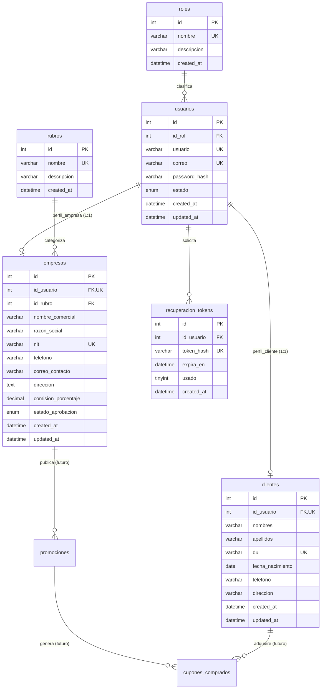

# Diseño y Diccionario de Base de Datos — La Cuponera SV

## 1. Diagrama Entidad-Relación

---

## 2. Decisión de Diseño: Separación de Autenticación y Perfiles

### Justificación Técnica
En el análisis del sistema se adoptó un modelo de **autenticación desacoplada**:
1. **Tabla Central `usuarios`:** Almacena exclusivamente los campos necesarios para la autenticación: identificador único de cuenta, credenciales hasheadas (`password_hash`), correo electrónico, estado de la cuenta (`activo`, `inactivo`, `bloqueado`) y rol (`id_rol`).
2. **Tablas Especializadas (`clientes`, `empresas`):** Cada tipo de cuenta tiene requerimientos completamente distintos:
   - Un **cliente** posee datos de persona natural: nombres, apellidos, DUI y fecha de nacimiento (para cálculo legal de mayoría de edad).
   - Una **empresa** posee datos de persona jurídica o comercial: razón social, nombre comercial, NIT salvadoreño, correo de contacto institucional y porcentaje de comisión.
3. **Ventajas Académicas y Profesionales:**
   - Evita tener una tabla de usuarios llena de campos nulos (`NULL`) innecesarios.
   - Permite que el proceso de inicio de sesión (`AuthController::login()`) sea unificado y limpio para cualquier actor.
   - Brinda a los compañeros de equipo la libertad de extender los campos de `empresas` o `clientes` sin alterar la lógica de login central.

---

## 3. Diccionario Detallado de Tablas

### 3.1. Tabla: `roles`
Catálogo de privilegios del sistema.

| Columna | Tipo | Nulo | Clave | Descripción |
| :--- | :--- | :---: | :---: | :--- |
| `id` | INT | NO | PK (AI) | Identificador numérico del rol. |
| `nombre` | VARCHAR(30) | NO | UK | Nombre del rol: `'administrador'`, `'cliente'`, `'empresa'`. |
| `descripcion` | VARCHAR(150) | SÍ | | Explicación del nivel de acceso. |
| `created_at` | DATETIME | NO | | Fecha de creación del registro. |

### 3.2. Tabla: `usuarios`
Núcleo común de credenciales y seguridad.

| Columna | Tipo | Nulo | Clave | Descripción |
| :--- | :--- | :---: | :---: | :--- |
| `id` | INT | NO | PK (AI) | Identificador primario del usuario. |
| `id_rol` | INT | NO | FK | Referencia a `roles(id)`. |
| `usuario` | VARCHAR(50) | NO | UK | Nombre de usuario alfanumérico único. |
| `correo` | VARCHAR(100) | NO | UK | Correo electrónico único del usuario. |
| `password_hash` | VARCHAR(255) | NO | | Hash Bcrypt generado con `password_hash()`. |
| `estado` | ENUM('activo', 'inactivo', 'bloqueado') | NO | | Estado operativo de la cuenta. |
| `created_at` | DATETIME | NO | | Marca temporal de registro. |
| `updated_at` | DATETIME | NO | | Marca temporal de última modificación. |

### 3.3. Tabla: `clientes` (Módulo Persona 1)
Información de clientes individuales compradores de cupones.

| Columna | Tipo | Nulo | Clave | Descripción |
| :--- | :--- | :---: | :---: | :--- |
| `id` | INT | NO | PK (AI) | Identificador primario del cliente. |
| `id_usuario` | INT | NO | FK, UK | Referencia 1:1 a `usuarios(id)` (`ON DELETE CASCADE`). |
| `nombres` | VARCHAR(80) | NO | | Nombres propios del cliente. |
| `apellidos` | VARCHAR(80) | NO | | Apellidos del cliente. |
| `dui` | VARCHAR(10) | NO | UK | Formato `00000000-0` (8 dígitos + guion + 1 dígito). |
| `fecha_nacimiento`| DATE | NO | | Fecha de nacimiento para validación de 18+ años. |
| `telefono` | VARCHAR(20) | SÍ | | Teléfono de contacto opcional. |
| `direccion` | VARCHAR(255) | SÍ | | Dirección residencial opcional. |

### 3.4. Tabla: `empresas` (Esqueleto Compartido)
Información comercial de comercios ofertantes.

| Columna | Tipo | Nulo | Clave | Descripción |
| :--- | :--- | :---: | :---: | :--- |
| `id` | INT | NO | PK (AI) | Identificador primario de la empresa. |
| `id_usuario` | INT | NO | FK, UK | Referencia 1:1 a `usuarios(id)` (`ON DELETE CASCADE`). |
| `id_rubro` | INT | SÍ | FK | Referencia a `rubros(id)`. |
| `nombre_comercial`| VARCHAR(120) | NO | | Nombre de marca visible al público. |
| `razon_social` | VARCHAR(150) | NO | | Nombre legal registrado en El Salvador. |
| `nit` | VARCHAR(20) | NO | UK | Número de Identificación Tributaria salvadoreño. |
| `telefono` | VARCHAR(20) | NO | | Teléfono de atención al cliente. |
| `correo_contacto`| VARCHAR(100) | NO | | Correo para notificaciones comerciales. |
| `direccion` | TEXT | NO | | Dirección física del establecimiento. |
| `comision_porcentaje` | DECIMAL(5,2) | NO | | Porcentaje de comisión para la plataforma (ej. 10.00). |
| `estado_aprobacion` | ENUM('pendiente', 'aprobada', 'rechazada') | NO | | Estado administrativo de validación del comercio. |

### 3.5. Tabla: `recuperacion_tokens` (Base Técnica Compartida)
Tokens criptográficos para restablecimiento de contraseñas.

| Columna | Tipo | Nulo | Clave | Descripción |
| :--- | :--- | :---: | :---: | :--- |
| `id` | INT | NO | PK (AI) | Identificador primario del token. |
| `id_usuario` | INT | NO | FK | Referencia a `usuarios(id)` (`ON DELETE CASCADE`). |
| `token_hash` | VARCHAR(64) | NO | UK | Hash SHA-256 del token aleatorio entregado al usuario. |
| `expira_en` | DATETIME | NO | | Fecha y hora límite de validez (1 hora por defecto). |
| `usado` | TINYINT(1) | NO | | 0 = No consumido, 1 = Consumido o invalidado. |
